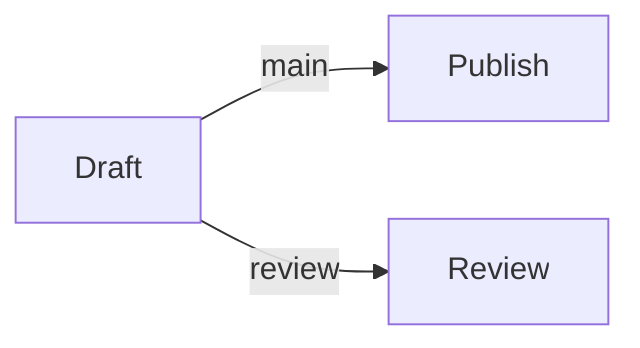

# nf-metro 2.1.0

The original Python CLI performs layout and SVG drawing. The browser adapter `N.mount(host, originalSVG)` pauses the SVG's native SMIL timeline and seeks it with page-local seconds. Geometry, text placement, colours, line routing, station marks and animation paths are the upstream output.

For EVERY new or revised page, write `materials/p01.mmd` (replace p01 with the current page id) and run:

```sh
node engine/tools/native-metro.mjs materials/p01.mmd --page p01 --theme light
```

This writes the complete `pages/p01.js` including the original SVG. Do not draw a replacement diagram or reuse a sample map for unrelated content. Preserve the .mmd source for revision. The authoring bridge requires a one-time local setup on the machine generating pages: `node engine/tools/native-metro.mjs --setup` (Python 3.11+; uv uses Python 3.12). Preview and exported films use the embedded SVG without Python, a server, an external service or Blender.

Input is Mermaid graph LR with native metro directives, e.g.:



Use line definitions and labelled edges as in this example. The dependency is pinned to 2.1.0; consult the preserved package code at `engine/native/sources/nf-metro/nf_metro` for extra layout directives. This project renders schematic networks and workflows; it does not provide real geographical railway data.
